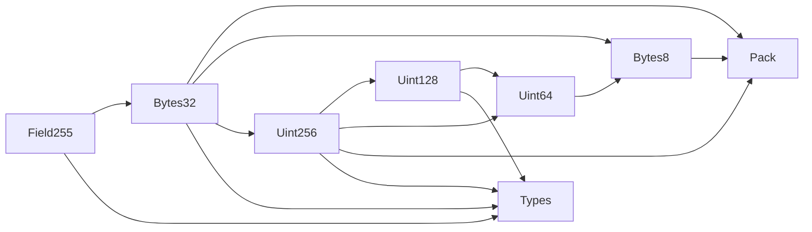

# Math

Use these modules for unsigned integer arithmetic, byte conversion, and integer comparisons in Compact contracts.
The modules have no ledger state. Consumer contracts control each public result and each ledger write.
Witness functions compute candidate values off chain. Circuit checks bind those values to the inputs.
Call `disclose()` when a witness-derived result crosses into public state or an exported return.

The package contains experimental code. Audit each production integration and its witness implementations.
The [migration guide](MIGRATION.md) lists the API paths, fixes, and native replacements.

## Modules and types

| Module | API |
|---|---|
| [Types](Types.compact) | `U128` and `U256` structs |
| [Pack](Pack.compact) | Generic `pack` and `unpack` byte conversions |
| [Bytes8](Bytes8.compact) | Eight-byte packing, unpacking, and conversion to `Uint<64>` |
| [Uint64](Uint64.compact) | Bounds, conversions, arithmetic, division, remainder, square root, minimum, and maximum |
| [Uint128](Uint128.compact) | The same integer operations for `Uint<128>` and `U128`, with comparisons and a full `U256` product |
| [Uint256](Uint256.compact) | Bounds, byte conversions, and comparisons for `U256` |
| [Bytes32](Bytes32.compact) | Packing, unpacking, conversion to `U256`, and integer comparisons |
| [Field255](Field255.compact) | A field bound, canonical byte conversion, conversion to `U256`, and integer comparisons |

`U128` has `low: Uint<64>` and `high: Uint<64>`. Its value is `high * 2^64 + low`.
`U256` has `low: U128` and `high: U128`. Its value is `high * 2^128 + low`.
Compact supports `Uint` widths through 248 bits. Use `U256` for a 256-bit value.
Byte conversions use little-endian order. `Field255` comparisons use the canonical nonnegative field representative.
Field arithmetic itself uses modular arithmetic.

`Uint64.add` and `Uint64.mul` return a widened `Uint<128>` result.
Both `Uint128.add` and `Uint128.mul` return `U256`.
The `addChecked` and `mulChecked` circuits reject results above the destination maximum.
Subtraction rejects underflow. Division rejects a zero divisor.
`div` returns the quotient. `divRem` returns a struct with `quotient` and `remainder`.
Square root returns the integer floor.

These are the direct imports. Each arrow points from a module to a module that it imports.



## Compile a consumer

Install `@openzeppelin/compact-contracts` and pin compiler 0.34.0 with runtime 0.19.0 in the consumer project.
The package path is `./node_modules/@openzeppelin/compact-contracts/math/<Module>`.
Use `import { sqrt } from "./node_modules/@openzeppelin/compact-contracts/math/Uint128" prefix Uint128_;` in a consumer at the project root.

The following complete example uses a relative import so it also compiles beside this guide.
Save it as `Pool.compact` in this directory for the command below.
For a separate project, use the package import path above.
The example publishes the integer square root of the reserve product.
Both reserves have type `Uint<64>`, so their product fits in `Uint<128>`.
The example discloses `root` for the public ledger cell and the exported return.
It provides an arithmetic example only. A production pool also needs its own authorization and accounting rules.

```compact
pragma language_version >= 0.26.0;

import CompactStandardLibrary;

import { sqrt } from "./Uint128" prefix Uint128_;

export ledger liquidity: Uint<64>;

export circuit update(reserve0: Uint<64>, reserve1: Uint<64>): Uint<64> {
  const root = Uint128_sqrt(reserve0 * reserve1);
  liquidity = disclose(root);
  return disclose(root);
}
```

```sh
compact compile +0.34.0 --skip-zk Pool.compact managed/Pool
```

Omit `--skip-zk` when generating proving and verification keys.
Use a proof server on the user's machine when the witness values must remain on that machine.
A remote proof server receives the private proof inputs.

## Supply the witnesses

Read the generated `Witnesses<PrivateState>` type from the consumer's `contract/index.d.ts`.
Supply exactly the reachable witness names. An unused module import does not add a witness.
The pool example requires `wit_divUint128` and `wit_sqrtU128`.
Each witness returns `[context.privateState, result]`.
These math witnesses keep the private state unchanged.

The following test reference uses the repository's witness factory.
Copy the arithmetic into an audited consumer implementation before production use.
The package excludes the `test/witnesses` directory.

```ts
import { Contract, type Witnesses } from './managed/Pool/contract/index.js';
import { Uint128Witnesses } from './test/witnesses/Uint128Witnesses.js';

type PrivateState = Record<string, never>;
const { wit_divUint128, wit_sqrtU128 } = Uint128Witnesses();
const witnesses = {
  wit_divUint128,
  wit_sqrtU128,
} satisfies Witnesses<PrivateState>;
const contract = new Contract<PrivateState>(witnesses);
```

The factory import above refers to a local test reference copied from this repository.
It is not a package export.
The [consumer witness file](test/witnesses/MathConsumerWitnesses.ts) checks the same two names against its generated type.
The [consumer test](test/MathConsumer.test.ts) checks both the returned value and the public ledger value.
Use the async simulator as follows:

```ts
import { MathConsumerSimulator } from './test/simulators/MathConsumerSimulator.js';

const pool = await MathConsumerSimulator.create();
const root = await pool.update(4n, 9n);
const state = await pool.getPublicState();
// root and state.liquidity are 6n.
```

### Witness contracts

The context parameter has type `WitnessContext<Ledger, PrivateState>`.
The table lists the parameters after the context and the result after the private state.
Use `bigint` for Compact integers and fields, `Uint8Array` for bytes, and `bigint[]` for byte vectors.

| Name | Parameters | Result | Reference |
|---|---|---|---|
| `wit_unpackBytes` | `bytes: Uint8Array` | `bigint[]`, one integer per byte | [PackWitnesses](test/witnesses/PackWitnesses.ts) |
| `wit_uint64ToUnpackedBytes` | `value: bigint` | Eight little-endian byte integers | [Uint64Witnesses](test/witnesses/Uint64Witnesses.ts) |
| `wit_divUint64` | `a: bigint, b: bigint` | `{ quotient: bigint, remainder: bigint }` | [Uint64Witnesses](test/witnesses/Uint64Witnesses.ts) |
| `wit_sqrtUint64` | `radicand: bigint` | Integer square root as `bigint` | [Uint64Witnesses](test/witnesses/Uint64Witnesses.ts) |
| `wit_divUint128` | `a: bigint, b: bigint` | `{ quotient: U128, remainder: U128 }` | [Uint128Witnesses](test/witnesses/Uint128Witnesses.ts) |
| `wit_divU128` | `a: U128, b: U128` | `{ quotient: U128, remainder: U128 }` | [Uint128Witnesses](test/witnesses/Uint128Witnesses.ts) |
| `wit_sqrtU128` | `radicand: U128` | Integer square root as `bigint` | [Uint128Witnesses](test/witnesses/Uint128Witnesses.ts) |

These names are global in the generated consumer interface.
An import prefix changes circuit names. It does not rename the witness keys.
All `Pack<N>` instances share `wit_unpackBytes`. Implement it for the input array length.
Avoid declaring another witness with the same name and an incompatible signature.

### Witness-dependent circuits and disclosure

The following table comes from separate compiler probes for every exported mock circuit.
Each probe first returns the value without `disclose()`.
A `yes` entry fails with `potential witness-value disclosure must be declared` and compiles after disclosure is added.
The witness names come from that probe's generated `Witnesses` declaration.
Unlisted circuits have no reachable witness and need no disclosure for public input values.
An input that itself comes from a witness can still make a native result private.

The table describes the implementation in this documentation branch before native-addition integration.
Both `Uint128.addChecked` overloads appear here because this branch still uses the splitter.
The [native-addition migration notes](MIGRATION.md#native-addition-and-witness-interfaces) describe the integration change.

| Circuit | Generated witness keys | Needs disclose() |
|---|---|---|
| `Pack.unpack(bytes: Bytes<N>): Vector<N, Uint<8>>` | `wit_unpackBytes` | yes |
| `Bytes8.unpack(bytes: Bytes<8>): Vector<8, Uint<8>>` | `wit_unpackBytes` | yes |
| `Bytes8.toUint64(bytes: Bytes<8>): Uint<64>` | `wit_unpackBytes` | yes |
| `Uint64.toBytes(value: Uint<64>): Bytes<8>` | `wit_uint64ToUnpackedBytes` | yes |
| `Uint64.toUnpackedBytes(value: Uint<64>): Vector<8, Uint<8>>` | `wit_uint64ToUnpackedBytes` | yes |
| `Uint64.div(a: Uint<64>, b: Uint<64>): Uint<64>` | `wit_divUint64` | yes |
| `Uint64.rem(a: Uint<64>, b: Uint<64>): Uint<64>` | `wit_divUint64` | yes |
| `Uint64.divRem(a: Uint<64>, b: Uint<64>): DivResultU64` | `wit_divUint64` | yes |
| `Uint64.sqrt(radical: Uint<64>): Uint<32>` | `wit_sqrtUint64` | yes |
| `Uint64.isMultiple(value: Uint<64>, b: Uint<64>): Boolean` | `wit_divUint64` | yes |
| `Uint128.toU128(value: Uint<128>): U128` | `wit_divUint128` | yes |
| `Uint128.add(a: Uint<128>, b: Uint<128>): U256` | `wit_divUint128` | yes |
| `Uint128.add(a: U128, b: U128): U256` | `wit_divUint128` | yes |
| `Uint128.addChecked(a: Uint<128>, b: Uint<128>): Uint<128>` | `wit_divUint128` | yes |
| `Uint128.addChecked(a: U128, b: U128): Uint<128>` | `wit_divUint128` | yes |
| `Uint128.mul(a: Uint<128>, b: Uint<128>): U256` | `wit_divUint128` | yes |
| `Uint128.mul(a: U128, b: U128): U256` | `wit_divUint128` | yes |
| `Uint128.mulChecked(a: Uint<128>, b: Uint<128>): Uint<128>` | `wit_divUint128` | yes |
| `Uint128.mulChecked(a: U128, b: U128): Uint<128>` | `wit_divUint128` | yes |
| `Uint128.div(a: Uint<128>, b: Uint<128>): Uint<128>` | `wit_divU128`, `wit_divUint128` | yes |
| `Uint128.div(a: U128, b: U128): U128` | `wit_divU128`, `wit_divUint128` | yes |
| `Uint128.rem(a: Uint<128>, b: Uint<128>): Uint<128>` | `wit_divU128`, `wit_divUint128` | yes |
| `Uint128.rem(a: U128, b: U128): U128` | `wit_divU128`, `wit_divUint128` | yes |
| `Uint128.divRem(a: Uint<128>, b: Uint<128>): DivResultU128` | `wit_divU128`, `wit_divUint128` | yes |
| `Uint128.divRem(a: U128, b: U128): DivResultU128` | `wit_divU128`, `wit_divUint128` | yes |
| `Uint128.sqrt(radicand: Uint<128>): Uint<64>` | `wit_divUint128`, `wit_sqrtU128` | yes |
| `Uint128.sqrt(radicand: U128): Uint<64>` | `wit_divUint128`, `wit_sqrtU128` | yes |
| `Uint128.isMultiple(value: Uint<128>, b: Uint<128>): Boolean` | `wit_divU128`, `wit_divUint128` | yes |
| `Uint128.isMultiple(value: U128, b: U128): Boolean` | `wit_divU128`, `wit_divUint128` | yes |
| `Uint256.toBytes(value: U256): Bytes<32>` | `wit_uint64ToUnpackedBytes` | yes |
| `Uint256.toUnpackedBytes(value: U256): Vector<32, Uint<8>>` | `wit_uint64ToUnpackedBytes` | yes |
| `Bytes32.unpack(bytes: Bytes<32>): Vector<32, Uint<8>>` | `wit_unpackBytes` | yes |
| `Bytes32.toU256(bytes: Bytes<32>): U256` | `wit_unpackBytes` | yes |
| `Bytes32.lt(a: Bytes<32>, b: Bytes<32>): Boolean` | `wit_unpackBytes` | yes |
| `Bytes32.lte(a: Bytes<32>, b: Bytes<32>): Boolean` | `wit_unpackBytes` | yes |
| `Bytes32.gt(a: Bytes<32>, b: Bytes<32>): Boolean` | `wit_unpackBytes` | yes |
| `Bytes32.gte(a: Bytes<32>, b: Bytes<32>): Boolean` | `wit_unpackBytes` | yes |
| `Field255.toU256(value: Field): U256` | `wit_unpackBytes` | yes |
| `Field255.lt(a: Field, b: Field): Boolean` | `wit_unpackBytes` | yes |
| `Field255.lte(a: Field, b: Field): Boolean` | `wit_unpackBytes` | yes |
| `Field255.gt(a: Field, b: Field): Boolean` | `wit_unpackBytes` | yes |
| `Field255.gte(a: Field, b: Field): Boolean` | `wit_unpackBytes` | yes |

`Uint128.mul` needs `wit_divUint128` in both forms.
`Uint256.toBytes` needs `wit_uint64ToUnpackedBytes`.
`Bytes32.lt` needs `wit_unpackBytes`.
Provide these dependencies when the consumer calls these circuits.

## Native alternatives

The [native replacement table](MIGRATION.md#deprecated-circuits) lists every deprecated declaration and its exact expression.
All deprecated declarations remain callable.
The following circuits keep a native alternative because they preserve a library failure message or have a lower v3 cost.
The replacement expressions assume the typed arguments in the listed signature.

Native casts have no math witness keys and do not add witness taint.
For public inputs, they need no `disclose()`.
They do not provide the library's incorrect-witness failure messages.
In particular, `Bytes8.toUint64(Bytes<8>)` and `Uint64.toBytes` retain their witness checks and remain undeprecated.

Rows use compiler 0.34.0. Each pair shows v2 / v3.

| Circuit | Native alternative | Library rows | Native rows | Reason to keep the circuit |
|---|---|---|---|---|
| `Pack.unpack(bytes: Bytes<N>): Vector<N, Uint<8>>` | `bytes as Vector<N, Uint<8>>` | 2484/240 | 2640/1151 | `Pack: unpack verification failed` |
| `Bytes8.unpack(bytes: Bytes<8>): Vector<8, Uint<8>>` | `bytes as Vector<8, Uint<8>>` | 2484/240 | 2640/1151 | `Pack: unpack verification failed` |
| `Bytes8.toUint64(vec: Vector<8, Uint<8>>): Uint<64>` | `(vec as Bytes<8>) as Uint<64>` | 191/157 | 2474/236 | Lower library v3 cost |
| `Bytes8.toUint64(bytes: Bytes<8>): Uint<64>` | `bytes as Uint<64>` | 2431/187 | 173/85 | `Pack: unpack verification failed` |
| `Uint64.toBytes(value: Uint<64>): Bytes<8>` | `value as Bytes<8>` | 2431/187 | 173/85 | `Uint64: toUnpackedBytes verification failed` |
| `Uint64.toUnpackedBytes(value: Uint<64>): Vector<8, Uint<8>>` | `(value as Bytes<8>) as Vector<8, Uint<8>>` | 265/177 | 2704/1167 | `Uint64: toUnpackedBytes verification failed` |
| `Uint64.addChecked(a: Uint<64>, b: Uint<64>): Uint<64>` | `(a + b) as Uint<64>` | 296/123 | 239/104 | `Uint64: addition overflow` |
| `Uint64.sub(a: Uint<64>, b: Uint<64>): Uint<64>` | `a - b` | 210/103 | 209/102 | `Uint64: subtraction underflow` |
| `Uint64.mulChecked(a: Uint<64>, b: Uint<64>): Uint<64>` | `(a * b) as Uint<64>` | 296/123 | 239/104 | `Uint64: multiplication overflow` |
| `Uint128.toU128(value: Uint<128>): U128` | `U128 { low: slice<8>((value as Bytes<16>), 0) as Uint<64>, high: slice<8>((value as Bytes<16>), 8) as Uint<64> }` | 439/159 | 16064/4870 | `Uint128: conversion invalid` |
| `Uint128.addChecked(a: Uint<128>, b: Uint<128>): Uint<128>` | `(a + b) as Uint<128>` | 1498/451 | 431/152 | `Uint128: addition overflow`; `Uint128: conversion invalid` |
| `Uint128.addChecked(a: U128, b: U128): Uint<128>` | `(((a.high * 0x10000000000000000 + a.low) as Uint<128>) + ((b.high * 0x10000000000000000 + b.low) as Uint<128>)) as Uint<128>` | 990/329 | 457/180 | `Uint128: addition overflow`; `Uint128: conversion invalid` |
| `Uint128.sub(a: Uint<128>, b: Uint<128>): Uint<128>` | `(a - b) as Uint<128>` | 362/141 | 361/140 | `Uint128: subtraction underflow` |
| `Uint128.sub(a: U128, b: U128): U128` | `U128 { low: slice<8>(((((a.high * 0x10000000000000000 + a.low) as Uint<128>) - ((b.high * 0x10000000000000000 + b.low) as Uint<128>)) as Uint<128> as Bytes<16>), 0) as Uint<64>, high: slice<8>(((((a.high * 0x10000000000000000 + a.low) as Uint<128>) - ((b.high * 0x10000000000000000 + b.low) as Uint<128>)) as Uint<128> as Bytes<16>), 8) as Uint<64> }` | 550/246 | 16280/4970 | `Uint128: subtraction underflow` |
| `Uint256.toBytes(value: U256): Bytes<32>` | `Bytes[...(value.low.low as Bytes<8>), ...(value.low.high as Bytes<8>), ...(value.high.low as Bytes<8>), ...(value.high.high as Bytes<8>)]` | 10271/628 | 19915/4500 | `Uint64: toUnpackedBytes verification failed` |
| `Uint256.toUnpackedBytes(value: U256): Vector<32, Uint<8>>` | `(Bytes[...(value.low.low as Bytes<8>), ...(value.low.high as Bytes<8>), ...(value.high.low as Bytes<8>), ...(value.high.high as Bytes<8>)]) as Vector<32, Uint<8>>` | 1031/658 | 30685/9120 | `Uint64: toUnpackedBytes verification failed` |
| `Uint256.eq(a: U256, b: U256): Boolean` | `a == b` | 642/267 | 642/268 | Lower library v3 cost |
| `Bytes32.unpack(bytes: Bytes<32>): Vector<32, Uint<8>>` | `bytes as Vector<32, Uint<8>>` | 10519/872 | 11123/4790 | `Pack: unpack verification failed` |
| `Bytes32.toU256(vec: Vector<32, Uint<8>>): U256` | `U256 { low: U128 { low: slice<8>((vec as Bytes<32>), 0) as Uint<64>, high: slice<8>((vec as Bytes<32>), 8) as Uint<64> }, high: U128 { low: slice<8>((vec as Bytes<32>), 16) as Uint<64>, high: slice<8>((vec as Bytes<32>), 24) as Uint<64> } }` | 737/578 | 70229/10733 | Lower library v3 cost |
| `Bytes32.toU256(bytes: Bytes<32>): U256` | `U256 { low: U128 { low: slice<8>((bytes as Bytes<32>), 0) as Uint<64>, high: slice<8>((bytes as Bytes<32>), 8) as Uint<64> }, high: U128 { low: slice<8>((bytes as Bytes<32>), 16) as Uint<64>, high: slice<8>((bytes as Bytes<32>), 24) as Uint<64> } }` | 10267/620 | 31805/9638 | `Pack: unpack verification failed` |
| `Bytes32.lt(a: Bytes<32>, b: Bytes<32>): Boolean` | `((slice<16>((a as Bytes<32>), 16) as Uint<128> < slice<16>((b as Bytes<32>), 16) as Uint<128>) \|\| (slice<16>((a as Bytes<32>), 16) == slice<16>((b as Bytes<32>), 16) && (slice<16>((a as Bytes<32>), 0) as Uint<128> < slice<16>((b as Bytes<32>), 0) as Uint<128>)))` | 20531/1122 | 74678/19600 | `Pack: unpack verification failed` |
| `Bytes32.lte(a: Bytes<32>, b: Bytes<32>): Boolean` | `((slice<16>((a as Bytes<32>), 16) as Uint<128> < slice<16>((b as Bytes<32>), 16) as Uint<128>) \|\| (slice<16>((a as Bytes<32>), 16) == slice<16>((b as Bytes<32>), 16) && (slice<16>((a as Bytes<32>), 0) as Uint<128> <= slice<16>((b as Bytes<32>), 0) as Uint<128>)))` | 20534/1124 | 74681/19601 | `Pack: unpack verification failed` |
| `Bytes32.gt(a: Bytes<32>, b: Bytes<32>): Boolean` | `((slice<16>((a as Bytes<32>), 16) as Uint<128> > slice<16>((b as Bytes<32>), 16) as Uint<128>) \|\| (slice<16>((a as Bytes<32>), 16) == slice<16>((b as Bytes<32>), 16) && (slice<16>((a as Bytes<32>), 0) as Uint<128> > slice<16>((b as Bytes<32>), 0) as Uint<128>)))` | 20531/1122 | 74678/19600 | `Pack: unpack verification failed` |
| `Bytes32.gte(a: Bytes<32>, b: Bytes<32>): Boolean` | `((slice<16>((a as Bytes<32>), 16) as Uint<128> > slice<16>((b as Bytes<32>), 16) as Uint<128>) \|\| (slice<16>((a as Bytes<32>), 16) == slice<16>((b as Bytes<32>), 16) && (slice<16>((a as Bytes<32>), 0) as Uint<128> >= slice<16>((b as Bytes<32>), 0) as Uint<128>)))` | 20534/1124 | 74681/19601 | `Pack: unpack verification failed` |
| `Field255.toU256(value: Field): U256` | `U256 { low: U128 { low: slice<8>((value as Bytes<32>), 0) as Uint<64>, high: slice<8>((value as Bytes<32>), 8) as Uint<64> }, high: U128 { low: slice<8>((value as Bytes<32>), 16) as Uint<64>, high: slice<8>((value as Bytes<32>), 24) as Uint<64> } }` | 10339/680 | 31876/9696 | `Pack: unpack verification failed` |
| `Field255.lt(a: Field, b: Field): Boolean` | `((slice<16>((a as Bytes<32>), 16) as Uint<128> < slice<16>((b as Bytes<32>), 16) as Uint<128>) \|\| (slice<16>((a as Bytes<32>), 16) == slice<16>((b as Bytes<32>), 16) && (slice<16>((a as Bytes<32>), 0) as Uint<128> < slice<16>((b as Bytes<32>), 0) as Uint<128>)))` | 20693/1260 | 98294/29458 | `Pack: unpack verification failed` |
| `Field255.lte(a: Field, b: Field): Boolean` | `((slice<16>((a as Bytes<32>), 16) as Uint<128> < slice<16>((b as Bytes<32>), 16) as Uint<128>) \|\| (slice<16>((a as Bytes<32>), 16) == slice<16>((b as Bytes<32>), 16) && (slice<16>((a as Bytes<32>), 0) as Uint<128> <= slice<16>((b as Bytes<32>), 0) as Uint<128>)))` | 20696/1262 | 98297/29459 | `Pack: unpack verification failed` |
| `Field255.gt(a: Field, b: Field): Boolean` | `((slice<16>((a as Bytes<32>), 16) as Uint<128> > slice<16>((b as Bytes<32>), 16) as Uint<128>) \|\| (slice<16>((a as Bytes<32>), 16) == slice<16>((b as Bytes<32>), 16) && (slice<16>((a as Bytes<32>), 0) as Uint<128> > slice<16>((b as Bytes<32>), 0) as Uint<128>)))` | 20693/1260 | 98294/29458 | `Pack: unpack verification failed` |
| `Field255.gte(a: Field, b: Field): Boolean` | `((slice<16>((a as Bytes<32>), 16) as Uint<128> > slice<16>((b as Bytes<32>), 16) as Uint<128>) \|\| (slice<16>((a as Bytes<32>), 16) == slice<16>((b as Bytes<32>), 16) && (slice<16>((a as Bytes<32>), 0) as Uint<128> >= slice<16>((b as Bytes<32>), 0) as Uint<128>)))` | 20696/1262 | 98297/29459 | `Pack: unpack verification failed` |

The checked native casts can reject with generic compiler messages.
Use the library wrapper when a caller needs `addition overflow`, `multiplication overflow`, or `subtraction underflow` with the module prefix.
A cheaper native expression alone does not replace that failure contract.

## Circuit cost

The table measures each original mock circuit with one Counter increment.
It includes that test ledger write. It is not an isolated cost for an inlined library call.
Compiler 0.34.0 produces the v2 and v3 figures below.
`compile:math` uses v2 by default. The package build uses v3.
Pack measurements use N = 8, 16 and 32.
Mock names with a `U128` suffix select the struct overload.
`vectorToUint64`, `bytesToUint64`, `vectorToU256`, and `bytesToU256` identify their input overloads.

| Circuit | k (v2) | Rows (v2) | k (v3) | Rows (v3) |
|---|---:|---:|---:|---:|
| Bytes32.bytesToU256 | 14 | 10267 | 10 | 620 |
| Bytes32.eq | 10 | 587 | 8 | 212 |
| Bytes32.gt | 15 | 20531 | 11 | 1122 |
| Bytes32.gte | 15 | 20534 | 11 | 1124 |
| Bytes32.isZero | 9 | 309 | 8 | 124 |
| Bytes32.lt | 15 | 20531 | 11 | 1122 |
| Bytes32.lte | 15 | 20534 | 11 | 1124 |
| Bytes32.pack | 14 | 10229 | 10 | 800 |
| Bytes32.unpack | 14 | 10519 | 10 | 872 |
| Bytes32.vectorToU256 | 10 | 737 | 10 | 578 |
| Bytes8.bytesToUint64 | 12 | 2431 | 9 | 187 |
| Bytes8.pack | 12 | 2410 | 9 | 220 |
| Bytes8.unpack | 12 | 2484 | 9 | 240 |
| Bytes8.vectorToUint64 | 8 | 191 | 8 | 157 |
| Field255.MAX_FIELD | 5 | 23 | 6 | 31 |
| Field255.eq | 6 | 48 | 6 | 57 |
| Field255.gt | 15 | 20693 | 11 | 1260 |
| Field255.gte | 15 | 20696 | 11 | 1262 |
| Field255.isZero | 6 | 47 | 6 | 55 |
| Field255.lt | 15 | 20693 | 11 | 1260 |
| Field255.lte | 15 | 20696 | 11 | 1262 |
| Field255.toBytes | 9 | 407 | 9 | 201 |
| Field255.toU256 | 14 | 10339 | 10 | 680 |
| Pack.pack16 | 13 | 5116 | 9 | 420 |
| Pack.pack32 | 14 | 10229 | 10 | 800 |
| Pack.pack8 | 12 | 2410 | 9 | 220 |
| Pack.unpack16 | 13 | 5260 | 9 | 456 |
| Pack.unpack32 | 14 | 10519 | 10 | 872 |
| Pack.unpack8 | 12 | 2484 | 9 | 240 |
| Uint128.MAX_U128 | 6 | 44 | 6 | 52 |
| Uint128.MAX_UINT128 | 5 | 23 | 6 | 31 |
| Uint128.MODULUS | 5 | 23 | 6 | 31 |
| Uint128.ZERO_U128 | 6 | 43 | 6 | 51 |
| Uint128.add | 11 | 1407 | 9 | 456 |
| Uint128.addChecked | 11 | 1498 | 9 | 451 |
| Uint128.addCheckedU128 | 10 | 990 | 9 | 329 |
| Uint128.addU128 | 10 | 899 | 9 | 334 |
| Uint128.div | 12 | 3356 | 11 | 1017 |
| Uint128.divRem | 12 | 3269 | 11 | 1026 |
| Uint128.divRemU128 | 12 | 2761 | 10 | 908 |
| Uint128.divU128 | 12 | 2739 | 10 | 886 |
| Uint128.eq | 9 | 304 | 7 | 121 |
| Uint128.eqU128 | 9 | 331 | 8 | 148 |
| Uint128.gt | 9 | 355 | 9 | 136 |
| Uint128.gtU128 | 9 | 390 | 9 | 169 |
| Uint128.gte | 9 | 358 | 9 | 137 |
| Uint128.gteU128 | 9 | 393 | 9 | 171 |
| Uint128.isMultiple | 12 | 3233 | 10 | 992 |
| Uint128.isMultipleU128 | 12 | 2725 | 10 | 870 |
| Uint128.isZero | 8 | 175 | 7 | 87 |
| Uint128.isZeroU128 | 8 | 181 | 7 | 92 |
| Uint128.lt | 9 | 355 | 9 | 136 |
| Uint128.ltU128 | 9 | 390 | 9 | 169 |
| Uint128.lte | 9 | 358 | 9 | 137 |
| Uint128.lteU128 | 9 | 393 | 9 | 171 |
| Uint128.max | 9 | 358 | 9 | 137 |
| Uint128.maxU128 | 9 | 417 | 9 | 193 |
| Uint128.min | 9 | 358 | 9 | 137 |
| Uint128.minU128 | 9 | 417 | 9 | 193 |
| Uint128.mul | 12 | 2743 | 10 | 832 |
| Uint128.mulChecked | 12 | 2838 | 10 | 829 |
| Uint128.mulCheckedU128 | 12 | 2330 | 10 | 707 |
| Uint128.mulU128 | 12 | 2235 | 10 | 710 |
| Uint128.rem | 12 | 3356 | 11 | 1017 |
| Uint128.remU128 | 12 | 2739 | 10 | 886 |
| Uint128.sqrt | 13 | 4125 | 11 | 1206 |
| Uint128.sqrtU128 | 12 | 3861 | 11 | 1135 |
| Uint128.sub | 9 | 362 | 9 | 141 |
| Uint128.subU128 | 10 | 550 | 9 | 246 |
| Uint128.toU128 | 9 | 439 | 8 | 159 |
| Uint128.toUint128 | 9 | 304 | 7 | 121 |
| Uint256.MAX_U256 | 7 | 66 | 7 | 74 |
| Uint256.ZERO_U256 | 7 | 63 | 7 | 71 |
| Uint256.eq | 10 | 642 | 9 | 267 |
| Uint256.gt | 10 | 768 | 9 | 314 |
| Uint256.gte | 10 | 771 | 9 | 316 |
| Uint256.lt | 10 | 768 | 9 | 314 |
| Uint256.lte | 10 | 771 | 9 | 316 |
| Uint256.toBytes | 14 | 10271 | 10 | 628 |
| Uint256.toUnpackedBytes | 11 | 1031 | 10 | 658 |
| Uint64.MAX_UINT16 | 5 | 23 | 6 | 31 |
| Uint64.MAX_UINT32 | 5 | 23 | 6 | 31 |
| Uint64.MAX_UINT64 | 5 | 23 | 6 | 31 |
| Uint64.MAX_UINT8 | 5 | 23 | 6 | 31 |
| Uint64.add | 8 | 175 | 7 | 88 |
| Uint64.addChecked | 9 | 296 | 9 | 123 |
| Uint64.div | 9 | 345 | 9 | 142 |
| Uint64.divRem | 9 | 366 | 9 | 163 |
| Uint64.isMultiple | 9 | 347 | 9 | 144 |
| Uint64.max | 9 | 206 | 9 | 99 |
| Uint64.min | 9 | 206 | 9 | 99 |
| Uint64.mul | 8 | 175 | 7 | 88 |
| Uint64.mulChecked | 9 | 296 | 9 | 123 |
| Uint64.rem | 9 | 345 | 9 | 142 |
| Uint64.sqrt | 9 | 240 | 9 | 114 |
| Uint64.sub | 9 | 210 | 9 | 103 |
| Uint64.toBytes | 12 | 2431 | 9 | 187 |
| Uint64.toUnpackedBytes | 9 | 265 | 8 | 177 |

## Toolchain

| Component | Pinned integration | SDK upgrade status |
|---|---|---|
| Compiler | 0.34.0, language 0.26.0 | 0.35.0, language 0.27.0, requires runtime 0.20.0 |
| Runtime | 0.19.0 | 0.20.0 changes `createCircuitContext` to an options object |
| Simulator | `@openzeppelin/compact-simulator` 0.4.1 | Its positional context call needs an update for runtime 0.20.0 |
| Ledger | Ledger 9 prerelease integration | Compiler 0.35.0 also targets ledger 9 |
| Backend | ZKIR v2 default; v3 with `--feature-zkir-v3` | Compiler main removes v2 and rejects that flag |
| Language pragma | `>= 0.26.0` | Ledger 8 compiler 0.31.1 uses language 0.23.0 and cannot satisfy this pragma |

The [0.35.0 release notes](https://github.com/midnightntwrk/compact/releases/tag/compactc-v0.35.0) specify the runtime and ledger requirements.
The source research compiles the math modules with 0.35.0 on both backends.
The complete upgraded simulator validation remains a separate integration check.
Keep the pinned compiler and runtime together until that check passes.
Recompile consumers and generate keys for the selected compiler and backend.

## Verification and limits

Circuit checks enforce quotient/remainder relations, square-root bounds, byte reconstruction, limb reconstruction, and arithmetic bounds.
The tests include boundary inputs, deterministic random inputs, and incorrect witness values.
The arithmetic proof models cover these relations and their intermediate bounds.
A generated constraint check and a live proof serve different purposes from the dry JavaScript tests.
The integration review owns the final Z3-to-artifact checks, relation attacks, and live proof runs.
Validate the full deployment stack with the selected compiler, backend, and network before production use.

The [source comments](Uint128.compact) state the circuit failure requirements.
Keep `U128` and `U256` values within their limb types.
Use `as Bytes<32>` for a canonical numeric Field conversion.
`upgradeFromTransient` and `degradeToTransient` are hash-domain conversions and do not provide the same numeric conversion.

## Related modules

`Utils.UINT128_MAX` remains available. Its math alternative is `Uint128.MAX_UINT128`.
Token and multisig modules keep their existing imports.
`EvmAbi` uses ABI encoding rules. Crypto modules use field, scalar, and hash-domain rules.
These rules need their own compatibility checks before a math conversion can substitute for them.
